# Results

Generated by `python -m research.figures`. Every number comes from research/runs/*/eval and research/results/.

**Comparison on the PlantVillage test set (38 classes, photos never seen in training)**

| Model | Params (M) | GFLOPs | Accuracy % (95% CI) | Macro-P % | Macro-R % | Macro-F1 % (95% CI) | Weighted-F1 % | Kappa | MCC | Macro ROC-AUC % | ECE | Top-3 % |
|---|---|---|---|---|---|---|---|---|---|---|---|---|
| MobileNetV2 (frozen) | 2.31 | 0.61 | 92.66 (92.07–93.25) | 91.11 | 91.59 | 90.81 (89.97–91.62) | 92.55 | 0.9230 | 0.9232 | 99.81 | 0.1497 | 98.55 |
| MobileNetV2 (fine-tuned) | 2.31 | 0.61 | 99.28 (99.09–99.44) | 99.04 | 98.99 | 99.01 (98.70–99.26) | 99.27 | 0.9924 | 0.9924 | 100.00 | 0.0944 | 99.98 |
| MobileNetV2 (fine-tuned) + QAA | 2.31 | 0.61 | 98.64 (98.38–98.88) | 98.53 | 98.60 | 98.55 (98.22–98.83) | 98.64 | 0.9857 | 0.9857 | 99.99 | 0.0987 | 99.95 |
| EfficientNetV2-B0 (fine-tuned) + QAA | 5.97 | 1.46 | 99.57 (99.43–99.71) | 99.42 | 99.55 | 99.48 (99.30–99.66) | 99.57 | 0.9955 | 0.9955 | 100.00 | 0.0938 | 99.98 |
| MobileNetV3-L (fine-tuned) + QAA | 3.03 | 0.44 | 99.40 (99.21–99.56) | 99.23 | 99.32 | 99.27 (98.99–99.48) | 99.40 | 0.9937 | 0.9937 | 100.00 | 0.0953 | 99.98 |
| ResNet50V2 (fine-tuned) + QAA | 23.64 | 6.99 | 98.38 (98.08–98.66) | 97.82 | 98.39 | 98.08 (97.67–98.46) | 98.39 | 0.9830 | 0.9830 | 99.99 | 0.0947 | 99.80 |
| DenseNet121 (fine-tuned) + QAA | 7.08 | 5.70 | 98.78 (98.54–99.03) | 98.48 | 98.79 | 98.62 (98.26–98.93) | 98.79 | 0.9873 | 0.9873 | 99.98 | 0.1010 | 99.93 |
| EfficientNetV2-B0 (fine-tuned) + QAA + PlantDoc | 5.97 | 1.46 | 99.50 (99.34–99.64) | 99.39 | 99.59 | 99.48 (99.28–99.65) | 99.50 | 0.9947 | 0.9947 | 99.98 | 0.0947 | 99.98 |
| MobileNetV2 (frozen) + auto-correct | 2.31 | 0.61 | 92.50 (91.89–93.09) | 90.93 | 91.47 | 90.65 (89.80–91.45) | 92.38 | 0.9214 | 0.9215 | 99.79 | 0.1483 | 98.45 |
| MobileNetV2 (fine-tuned) + QAA + auto-correct | 2.31 | 0.61 | 98.59 (98.32–98.83) | 98.47 | 98.56 | 98.50 (98.17–98.79) | 98.59 | 0.9852 | 0.9852 | 99.99 | 0.0987 | 99.94 |
| Handcrafted + Random Forest | - | - | 93.89 (93.36–94.38) | 94.49 | 90.77 | 92.34 (91.40–93.08) | 93.77 | 0.9358 | 0.9359 | 99.83 | 0.3245 | 98.74 |
| Handcrafted + SVM | - | - | 94.21 (93.70–94.68) | 92.20 | 93.95 | 93.00 (92.23–93.60) | 94.23 | 0.9393 | 0.9393 | 99.89 | 0.0555 | 98.88 |

**Cross-dataset test: trained on PlantVillage (lab), tested on PlantDoc (field photos)**

| Model | PlantDoc split | Photos | Accuracy % | Macro-F1 % | Restricted acc. % | Restricted macro-F1 % | Crop correct % | Healthy vs diseased % | Answered at 70% conf. % | Accuracy when answered % |
|---|---|---|---|---|---|---|---|---|---|---|
| MobileNetV2 (frozen) | official | 235 | 26.81 | 24.68 | 29.79 | 25.71 | 50.64 | 77.02 | 14.5 | 47.1 |
| MobileNetV2 (frozen) | deduplicated | 221 | 26.70 | 24.17 | 29.86 | 25.28 | 50.23 | 76.92 | 14.9 | 45.5 |
| MobileNetV2 (fine-tuned) | official | 235 | 30.21 | 27.11 | 31.49 | 27.01 | 52.77 | 83.83 | 31.5 | 50.0 |
| MobileNetV2 (fine-tuned) | deduplicated | 221 | 30.32 | 26.01 | 31.67 | 25.96 | 53.39 | 83.26 | 30.8 | 51.5 |
| MobileNetV2 (fine-tuned) + QAA | official | 235 | 37.87 | 37.00 | 38.30 | 35.73 | 59.15 | 90.64 | 31.1 | 52.1 |
| MobileNetV2 (fine-tuned) + QAA | deduplicated | 221 | 38.01 | 35.81 | 38.46 | 34.58 | 59.28 | 90.05 | 31.2 | 52.2 |
| EfficientNetV2-B0 (fine-tuned) + QAA | official | 235 | 34.89 | 34.11 | 37.45 | 34.40 | 62.55 | 86.38 | 44.3 | 51.0 |
| EfficientNetV2-B0 (fine-tuned) + QAA | deduplicated | 221 | 36.20 | 34.31 | 38.91 | 34.53 | 62.44 | 85.52 | 42.5 | 54.3 |
| MobileNetV3-L (fine-tuned) + QAA | official | 235 | 32.77 | 32.08 | 35.74 | 34.05 | 59.15 | 88.94 | 32.8 | 48.1 |
| MobileNetV3-L (fine-tuned) + QAA | deduplicated | 221 | 33.03 | 31.00 | 36.20 | 33.15 | 59.28 | 88.24 | 33.5 | 47.3 |
| ResNet50V2 (fine-tuned) + QAA | official | 235 | 28.51 | 27.27 | 32.34 | 28.98 | 54.47 | 83.40 | 30.2 | 46.5 |
| ResNet50V2 (fine-tuned) + QAA | deduplicated | 221 | 28.96 | 26.97 | 33.03 | 28.62 | 54.30 | 82.81 | 30.8 | 45.6 |
| DenseNet121 (fine-tuned) + QAA | official | 235 | 27.66 | 26.18 | 30.64 | 27.32 | 51.91 | 87.66 | 20.9 | 55.1 |
| DenseNet121 (fine-tuned) + QAA | deduplicated | 221 | 28.51 | 26.38 | 31.22 | 26.84 | 52.49 | 86.88 | 21.7 | 56.2 |
| EfficientNetV2-B0 (fine-tuned) + QAA + PlantDoc | official | 235 | 63.83 | 62.79 | 64.26 | 62.76 | 85.96 | 94.47 | 64.7 | 74.3 |
| EfficientNetV2-B0 (fine-tuned) + QAA + PlantDoc | deduplicated | 221 | 65.61 | 63.17 | 66.06 | 63.04 | 85.52 | 94.12 | 62.9 | 77.7 |
| MobileNetV2 (frozen) + auto-correct | official | 235 | 26.81 | 24.72 | 29.79 | 25.72 | 50.64 | 76.60 | 14.9 | 45.7 |
| MobileNetV2 (frozen) + auto-correct | deduplicated | 221 | 26.70 | 24.21 | 29.86 | 25.28 | 50.23 | 76.47 | 15.4 | 44.1 |
| MobileNetV2 (fine-tuned) + QAA + auto-correct | official | 235 | 37.87 | 37.05 | 38.30 | 35.69 | 59.15 | 90.64 | 31.5 | 51.4 |
| MobileNetV2 (fine-tuned) + QAA + auto-correct | deduplicated | 221 | 38.01 | 35.86 | 38.46 | 34.54 | 59.28 | 90.05 | 31.7 | 51.4 |
| Handcrafted + Random Forest | official | 235 | 4.68 | 2.87 | 5.53 | 3.37 | 23.40 | 59.15 | 0.0 | - |
| Handcrafted + Random Forest | deduplicated | 221 | 4.52 | 2.46 | 5.43 | 3.22 | 22.62 | 58.37 | 0.0 | - |
| Handcrafted + SVM | official | 235 | 3.40 | 3.47 | 5.53 | 3.59 | 21.28 | 68.51 | 43.8 | 1.0 |
| Handcrafted + SVM | deduplicated | 221 | 2.71 | 2.72 | 4.98 | 3.36 | 20.81 | 69.68 | 44.8 | 0.0 |

**Robustness to photo degradations (PlantVillage test subset); lower mCE is better**

| Model | Clean acc. % | Corrupted acc. % (seen types) | Corrupted acc. % (unseen types) | Relative robustness % | mCE (baseline = 100) | Brightness range (<=5 pt drop) | Max noise sigma (<=5 pt drop) |
|---|---|---|---|---|---|---|---|
| MobileNetV2 (frozen) | 92.33 | 66.13 | 39.30 | 63.70 | 100.0 | 0.57–1.76 | 6 |
| MobileNetV2 (fine-tuned) | 98.66 | 67.30 | 48.51 | 63.02 | 92.7 | 0.60–1.58 | 11 |
| MobileNetV2 (fine-tuned) + QAA | 98.44 | 93.53 | 89.42 | 93.87 | 18.9 | 0.10–2.58 | 51 |
| EfficientNetV2-B0 (fine-tuned) + QAA | 99.20 | 96.72 | 96.71 | 97.50 | 8.5 | 0.10–2.94 | 80 |
| MobileNetV3-L (fine-tuned) + QAA | 99.52 | 96.38 | 95.80 | 96.69 | 9.8 | - | - |
| ResNet50V2 (fine-tuned) + QAA | 98.39 | 92.85 | - | 94.37 | 18.7 | - | - |
| DenseNet121 (fine-tuned) + QAA | 98.71 | 93.99 | - | 95.22 | 15.6 | - | - |
| EfficientNetV2-B0 (fine-tuned) + QAA + PlantDoc | 99.46 | 96.18 | 95.27 | 96.45 | 10.2 | 0.10–2.89 | 73 |
| MobileNetV2 (frozen) + auto-correct | 92.06 | 69.42 | 48.24 | 69.13 | 88.0 | - | - |
| MobileNetV2 (fine-tuned) + QAA + auto-correct | 98.39 | 91.90 | 86.30 | 91.85 | 21.7 | - | - |
| Handcrafted + Random Forest | 91.20 | 37.19 | - | 40.78 | 171.3 | - | - |
| Handcrafted + SVM | 93.88 | 37.88 | - | 40.35 | 172.2 | - | - |

**McNemar's test p-values on the PlantVillage test (* = significant at 0.05)**

| Model | MobileNetV2 (frozen) | MobileNetV2 (fine-tuned) | MobileNetV2 (fine-tuned) + QAA | EfficientNetV2-B0 (fine-tuned) + QAA | MobileNetV3-L (fine-tuned) + QAA | ResNet50V2 (fine-tuned) + QAA | DenseNet121 (fine-tuned) + QAA | EfficientNetV2-B0 (fine-tuned) + QAA + PlantDoc | Handcrafted + Random Forest | Handcrafted + SVM |
|---|---|---|---|---|---|---|---|---|---|---|
| MobileNetV2 (frozen) | – | 7.2e-112* | 5.1e-98* | 1.2e-118* | 1.4e-115* | 8.4e-88* | 1.3e-100* | 8.7e-121* | 6.9e-04* | 1.0e-05* |
| MobileNetV2 (fine-tuned) | 7.2e-112* | – | 2.6e-07* | 3.0e-03* | 2.8e-01 | 7.7e-10* | 2.9e-04* | 5.8e-02 | 1.9e-81* | 8.8e-78* |
| MobileNetV2 (fine-tuned) + QAA | 5.1e-98* | 2.6e-07* | – | 1.9e-13* | 1.3e-10* | 8.1e-02 | 3.0e-01 | 3.1e-13* | 1.6e-62* | 3.3e-58* |
| EfficientNetV2-B0 (fine-tuned) + QAA | 1.2e-118* | 3.0e-03* | 1.9e-13* | – | 5.5e-02 | 2.6e-18* | 1.3e-10* | 3.4e-01 | 1.5e-93* | 1.6e-90* |
| MobileNetV3-L (fine-tuned) + QAA | 1.4e-115* | 2.8e-01 | 1.3e-10* | 5.5e-02 | – | 2.2e-15* | 2.4e-07* | 3.7e-01 | 4.5e-87* | 3.5e-83* |
| ResNet50V2 (fine-tuned) + QAA | 8.4e-88* | 7.7e-10* | 8.1e-02 | 2.6e-18* | 2.2e-15* | – | 2.6e-03* | 7.7e-17* | 1.4e-55* | 1.6e-52* |
| DenseNet121 (fine-tuned) + QAA | 1.3e-100* | 2.9e-04* | 3.0e-01 | 1.3e-10* | 2.4e-07* | 2.6e-03* | – | 7.9e-10* | 7.7e-67* | 2.5e-65* |
| EfficientNetV2-B0 (fine-tuned) + QAA + PlantDoc | 8.7e-121* | 5.8e-02 | 3.1e-13* | 3.4e-01 | 3.7e-01 | 7.7e-17* | 7.9e-10* | – | 3.0e-89* | 1.3e-88* |
| Handcrafted + Random Forest | 6.9e-04* | 1.9e-81* | 1.6e-62* | 1.5e-93* | 4.5e-87* | 1.4e-55* | 7.7e-67* | 3.0e-89* | – | 3.1e-01 |
| Handcrafted + SVM | 1.0e-05* | 8.8e-78* | 3.3e-58* | 1.6e-90* | 3.5e-83* | 1.6e-52* | 2.5e-65* | 1.3e-88* | 3.1e-01 | – |

**McNemar's test p-values on the PlantDoc test (* = significant at 0.05)**

| Model | MobileNetV2 (frozen) | MobileNetV2 (fine-tuned) | MobileNetV2 (fine-tuned) + QAA | EfficientNetV2-B0 (fine-tuned) + QAA | MobileNetV3-L (fine-tuned) + QAA | ResNet50V2 (fine-tuned) + QAA | DenseNet121 (fine-tuned) + QAA | EfficientNetV2-B0 (fine-tuned) + QAA + PlantDoc | Handcrafted + Random Forest | Handcrafted + SVM |
|---|---|---|---|---|---|---|---|---|---|---|
| MobileNetV2 (frozen) | – | 3.3e-01 | 5.3e-04* | 1.5e-02* | 6.6e-02 | 6.5e-01 | 8.8e-01 | 1.1e-15* | 3.9e-12* | 8.5e-13* |
| MobileNetV2 (fine-tuned) | 3.3e-01 | – | 7.2e-03* | 1.4e-01 | 4.0e-01 | 6.5e-01 | 4.5e-01 | 4.7e-14* | 1.8e-12* | 1.5e-14* |
| MobileNetV2 (fine-tuned) + QAA | 5.3e-04* | 7.2e-03* | – | 3.1e-01 | 5.2e-02 | 4.7e-04* | 2.8e-04* | 1.3e-10* | 4.4e-17* | 6.2e-19* |
| EfficientNetV2-B0 (fine-tuned) + QAA | 1.5e-02* | 1.4e-01 | 3.1e-01 | – | 4.6e-01 | 2.1e-02* | 4.1e-03* | 2.7e-13* | 7.4e-15* | 5.6e-17* |
| MobileNetV3-L (fine-tuned) + QAA | 6.6e-02 | 4.0e-01 | 5.2e-02 | 4.6e-01 | – | 1.1e-01 | 4.5e-02* | 2.7e-13* | 1.9e-14* | 2.7e-16* |
| ResNet50V2 (fine-tuned) + QAA | 6.5e-01 | 6.5e-01 | 4.7e-04* | 2.1e-02* | 1.1e-01 | – | 8.4e-01 | 1.2e-15* | 1.3e-11* | 1.1e-13* |
| DenseNet121 (fine-tuned) + QAA | 8.8e-01 | 4.5e-01 | 2.8e-04* | 4.1e-03* | 4.5e-02* | 8.4e-01 | – | 6.4e-17* | 1.7e-11* | 3.1e-13* |
| EfficientNetV2-B0 (fine-tuned) + QAA + PlantDoc | 1.1e-15* | 4.7e-14* | 1.3e-10* | 2.7e-13* | 2.7e-13* | 1.2e-15* | 6.4e-17* | – | 1.2e-29* | 1.8e-31* |
| Handcrafted + Random Forest | 3.9e-12* | 1.8e-12* | 4.4e-17* | 7.4e-15* | 1.9e-14* | 1.3e-11* | 1.7e-11* | 1.2e-29* | – | 5.8e-01 |
| Handcrafted + SVM | 8.5e-13* | 1.5e-14* | 6.2e-19* | 5.6e-17* | 2.7e-16* | 1.1e-13* | 3.1e-13* | 1.8e-31* | 5.8e-01 | – |

**Deployment cost: model size, single-photo CPU latency and quantization**

| Model | Format | Size (MB) | CPU latency (ms/photo) | Accuracy % (50/class subset) | Agreement with float32 % |
|---|---|---|---|---|---|
| MobileNetV2 (frozen) | Keras float32 | 9.4 | 113.3 | 92.27 | 100.00 |
| MobileNetV2 (frozen) | TFLite float32 | 8.64 | 2.0 | 92.27 | 100.00 |
| MobileNetV2 (frozen) | TFLite float16 | 4.35 | 2.0 | 92.17 | 99.57 |
| MobileNetV2 (frozen) | TFLite dynamic int8 | 2.44 | 32.3 | 91.79 | 97.21 |
| MobileNetV2 (frozen) | TFLite full int8 | 2.63 | 2.2 | 91.09 | 94.96 |
| MobileNetV2 (fine-tuned) | Keras float32 | 9.4 | 119.4 | 98.66 | 100.00 |
| MobileNetV2 (fine-tuned) + QAA | Keras float32 | 9.4 | 120.5 | 98.44 | 100.00 |
| MobileNetV2 (fine-tuned) + QAA | TFLite float32 | 8.64 | 2.0 | 98.44 | 100.00 |
| MobileNetV2 (fine-tuned) + QAA | TFLite float16 | 4.35 | 2.0 | 98.50 | 99.95 |
| MobileNetV2 (fine-tuned) + QAA | TFLite dynamic int8 | 2.44 | 32.9 | 98.61 | 99.73 |
| MobileNetV2 (fine-tuned) + QAA | TFLite full int8 | 2.63 | 2.1 | 98.44 | 99.46 |
| EfficientNetV2-B0 (fine-tuned) + QAA | Keras float32 | 23.7 | 242.8 | 99.20 | 100.00 |
| MobileNetV3-L (fine-tuned) + QAA | Keras float32 | 12.2 | 140.6 | 99.52 | 100.00 |
| ResNet50V2 (fine-tuned) + QAA | Keras float32 | 90.8 | 204.0 | 98.34 | 100.00 |
| DenseNet121 (fine-tuned) + QAA | Keras float32 | 28.4 | 380.3 | 98.71 | 100.00 |
| EfficientNetV2-B0 (fine-tuned) + QAA + PlantDoc | Keras float32 | 23.7 | 242.6 | 99.46 | 100.00 |
| EfficientNetV2-B0 (fine-tuned) + QAA + PlantDoc | TFLite float32 | 22.52 | 5.5 | 99.46 | 100.00 |
| EfficientNetV2-B0 (fine-tuned) + QAA + PlantDoc | TFLite float16 | 11.33 | 5.8 | 99.46 | 100.00 |
| EfficientNetV2-B0 (fine-tuned) + QAA + PlantDoc | TFLite dynamic int8 | 6.34 | 12.5 | 99.36 | 99.89 |
| EfficientNetV2-B0 (fine-tuned) + QAA + PlantDoc | TFLite full int8 | 6.85 | 4.8 | 99.30 | 99.73 |

**Temperature scaling fitted on the PlantVillage validation set (before → after): it fixes lab calibration but worsens field calibration**

| Model | Temperature | PV ECE | PV answered at 0.7 % | PV acc. when answered % | PlantDoc ECE | PlantDoc answered at 0.7 % | PlantDoc acc. when answered % |
|---|---|---|---|---|---|---|---|
| MobileNetV2 (frozen) | 0.505 | 0.150 → 0.013 | 71 → 91 | 98.8 → 96.4 | 0.163 → 0.403 | 14 → 47 | 47.1 → 35.5 |
| MobileNetV2 (fine-tuned) | 0.579 | 0.094 → 0.003 | 98 → 99 | 99.7 → 99.5 | 0.226 → 0.453 | 31 → 61 | 50.0 → 42.4 |
| MobileNetV2 (fine-tuned) + QAA | 0.560 | 0.099 → 0.003 | 96 → 99 | 99.6 → 99.2 | 0.188 → 0.393 | 31 → 66 | 52.1 → 43.9 |
| EfficientNetV2-B0 (fine-tuned) + QAA | 0.519 | 0.094 → 0.002 | 99 → 100 | 99.9 → 99.7 | 0.265 → 0.508 | 44 → 79 | 51.0 → 39.8 |
| MobileNetV3-L (fine-tuned) + QAA | 0.546 | 0.095 → 0.002 | 99 → 100 | 99.8 → 99.6 | 0.224 → 0.460 | 33 → 70 | 48.1 → 43.3 |
| ResNet50V2 (fine-tuned) + QAA | 0.539 | 0.095 → 0.004 | 95 → 99 | 99.7 → 98.9 | 0.253 → 0.492 | 30 → 64 | 46.5 → 35.3 |
| DenseNet121 (fine-tuned) + QAA | 0.499 | 0.101 → 0.002 | 95 → 99 | 99.8 → 99.3 | 0.202 → 0.478 | 21 → 61 | 55.1 → 35.4 |
| EfficientNetV2-B0 (fine-tuned) + QAA + PlantDoc | 0.547 | 0.095 → 0.002 | 99 → 100 | 99.9 → 99.7 | 0.136 → 0.260 | 65 → 83 | 74.3 → 68.0 |

Limit = where accuracy falls more than 5 percentage points below clean.

| Degradation | E8_best_ft_qaa_plantdoc | E1_mnv2_frozen_std | E2_mnv2_ft_std | E3_mnv2_ft_qaa | E4_effv2b0_ft_qaa |
|---|---|---|---|---|---|
| brightness_high | 2.89 -> brightness 236 | 1.76 -> brightness 201 | 1.58 -> brightness 188 | 2.58 -> brightness 231 | 2.94 -> brightness 237 |
| brightness_high_overexposed | 2.89 -> overexposed 0.676 | 1.76 -> overexposed 0.293 | 1.58 -> overexposed 0.163 | 2.58 -> overexposed 0.61 | 2.94 -> overexposed 0.687 |
| brightness_low | 0.1 (whole range ok) -> brightness 12.3 | 0.57 -> brightness 69.9 | 0.598 -> brightness 73.3 | 0.1 (whole range ok) -> brightness 12.3 | 0.1 (whole range ok) -> brightness 12.3 |
| brightness_low_underexposed | 0.1 (whole range ok) -> underexposed 0.0505 | 0.57 -> underexposed 0 | 0.598 -> underexposed 0 | 0.1 (whole range ok) -> underexposed 0.0505 | 0.1 (whole range ok) -> underexposed 0.0505 |
| color_cast_high | 0.5 (whole range ok) | 0.288 | 0.215 | 0.5 (whole range ok) | 0.5 (whole range ok) |
| color_cast_low | -0.5 (whole range ok) | -0.226 | -0.191 | -0.5 (whole range ok) | -0.5 (whole range ok) |
| contrast_low | 0.15 -> contrast 6.03 | 0.591 -> contrast 23.8 | 0.661 -> contrast 26.6 | 0.178 -> contrast 7.17 | 0.1 (whole range ok) -> contrast 4.03 |
| gamma_high_brightness | 4 (whole range ok) -> brightness 22.4 | 2.23 -> brightness 58.5 | 2.62 -> brightness 46.6 | 4 (whole range ok) -> brightness 22.4 | 4 (whole range ok) -> brightness 22.4 |
| gamma_low_brightness | 0.3 (whole range ok) -> brightness 201 | 0.486 -> brightness 175 | 0.49 -> brightness 175 | 0.3 (whole range ok) -> brightness 201 | 0.3 (whole range ok) -> brightness 201 |
| gaussian_blur_high_sharpness | 4.35 -> sharpness 1.07 | 1.19 -> sharpness 25.4 | 1.06 -> sharpness 31.7 | 4.09 -> sharpness 1.14 | 4.58 -> sharpness 1.01 |
| gaussian_noise_high | 72.8 -> noise 63.8 | 5.98 -> noise 7.67 | 11.1 -> noise 12.1 | 51.2 -> noise 48.4 | 80 (whole range ok) -> noise 68.6 |
| jpeg_low | 9.55 | 41.4 | 24.1 | 9.97 | 9.1 |
| motion_blur_high_sharpness | 15.2 -> sharpness 27.1 | 3.31 -> sharpness 152 | 4.39 -> sharpness 111 | 11.3 -> sharpness 37.3 | 19.2 -> sharpness 21.2 |
| resolution_low | 29.5 | 90.6 | 95.5 | 36.8 | 27.9 |
| salt_pepper_high_noise | 0.131 -> noise 42.6 | 0.0014 -> noise 4.59 | 0.00947 -> noise 7.61 | 0.0262 -> noise 13.7 | 0.14 -> noise 44.7 |
| speckle_high_noise | 0.5 (whole range ok) -> noise 68.8 | 0.00338 -> noise 7.09 | 0.0112 -> noise 13.6 | 0.185 -> noise 47.7 | 0.5 (whole range ok) -> noise 68.8 |

**Published results as reported by their authors (protocols differ, so the numbers are indicative, not a head-to-head comparison)**

| Work | Model | Dataset | Protocol | Accuracy | Field / cross-dataset |
|---|---|---|---|---|---|
| Mohanty et al. 2016 | GoogLeNet, transfer learning | PlantVillage, colour (54,306 photos, 38 classes) | 80/20 random split | 99.35% | 31.40% on 121 web photos taken in other conditions (47.93% when the crop is given) |
| Singh et al. 2020 (PlantDoc) | VGG16 | Trained on PlantVillage | Tested on all of uncropped PlantDoc, 100 x 100 input | - | 15.08% (F1 0.15) |
| Singh et al. 2020 (PlantDoc) | VGG16 / InceptionV3 / InceptionResNetV2 | Trained on PlantVillage | Tested on all of cropped PlantDoc (single leaves) | - | 19.73% / 30.78% / 39.87% |
| Singh et al. 2020 (PlantDoc) | VGG16 | ImageNet + PlantVillage weights, fine-tuned on 80% of uncropped PlantDoc | Tested on 20% of uncropped PlantDoc | - | 29.73% (F1 0.28) |
| Singh et al. 2020 (PlantDoc) | InceptionResNetV2 | ImageNet + PlantVillage weights, fine-tuned on 80% of cropped PlantDoc | Tested on 20% of cropped PlantDoc | - | 70.53% (F1 0.70) |
| Noyan 2022 | Classifier on 8 background pixels only | PlantVillage | Held-out test set | 49.0% (random guessing 2.6%) | Shows label-correlated capture bias in PlantVillage |

## Figures

- 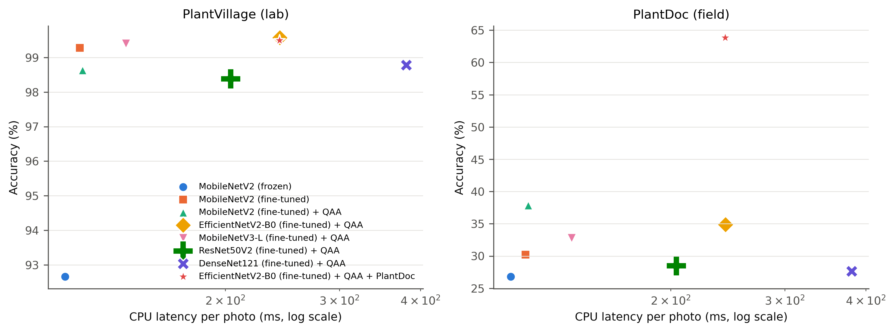
- 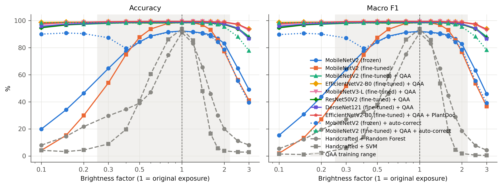
- 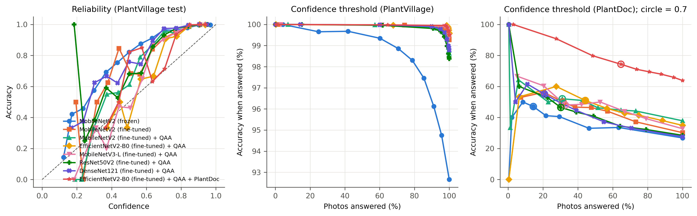
- 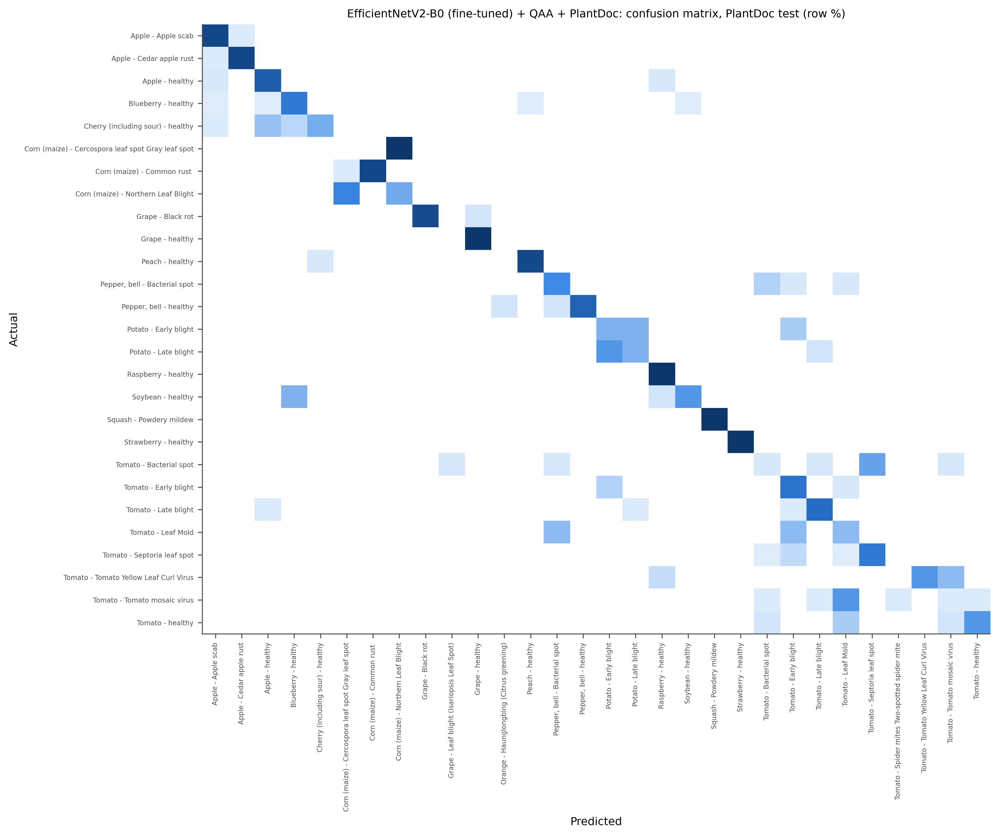
- 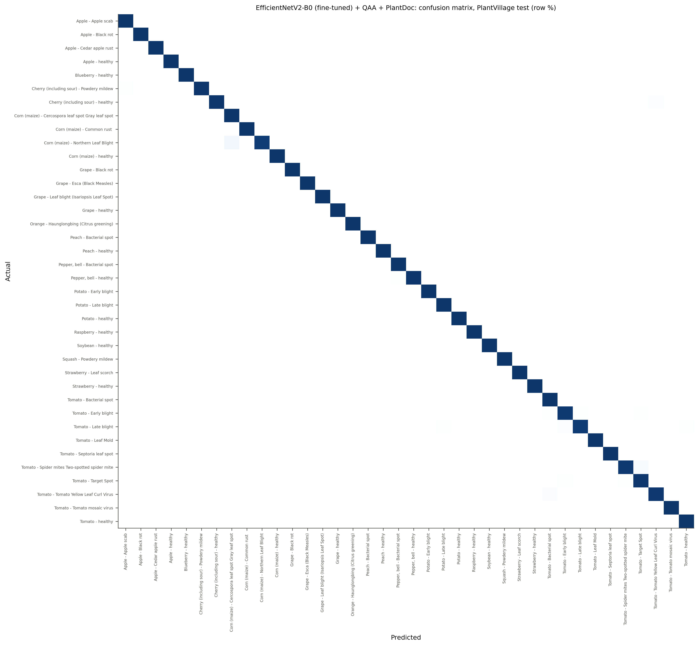
- 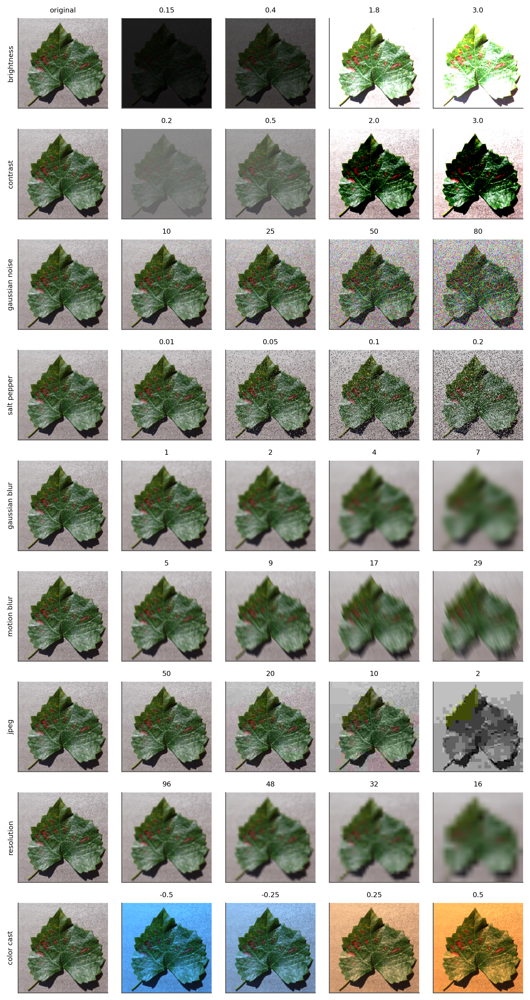
- 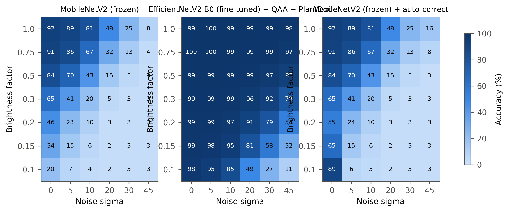
- 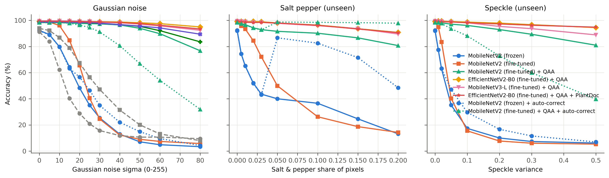
- 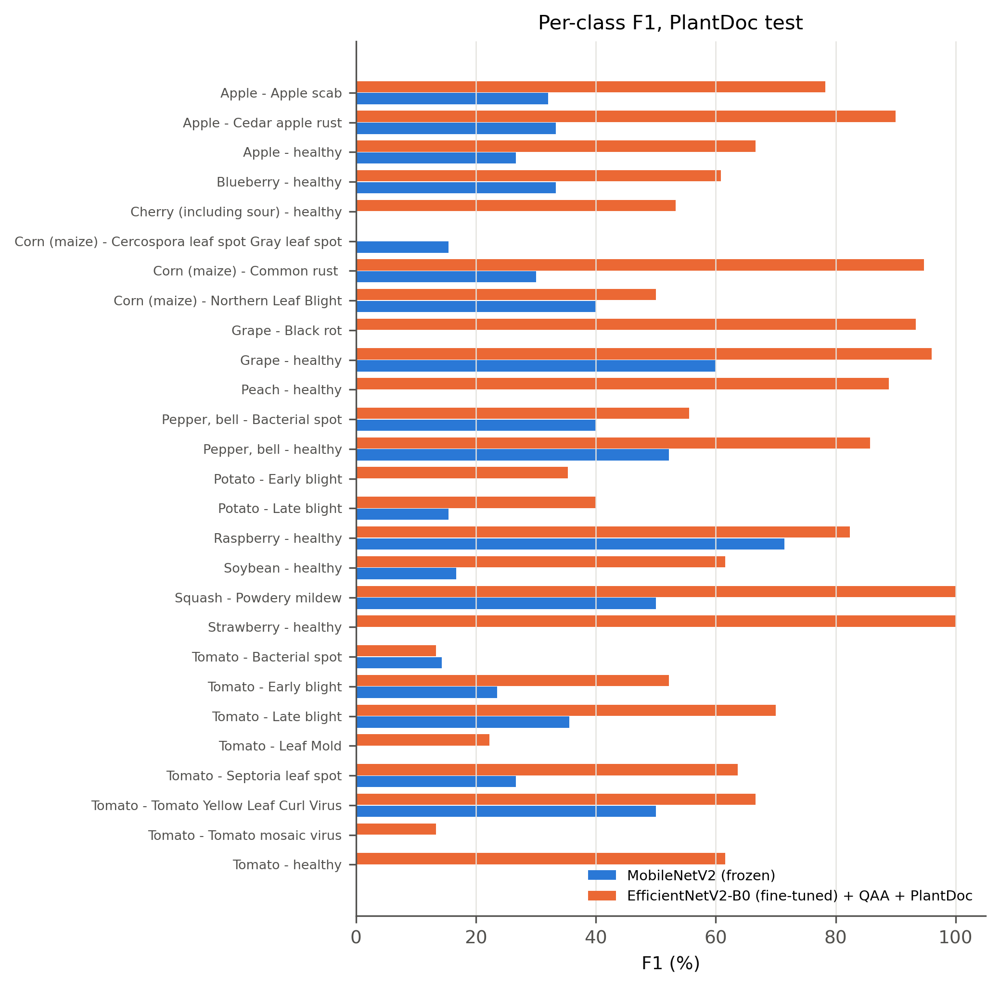
- 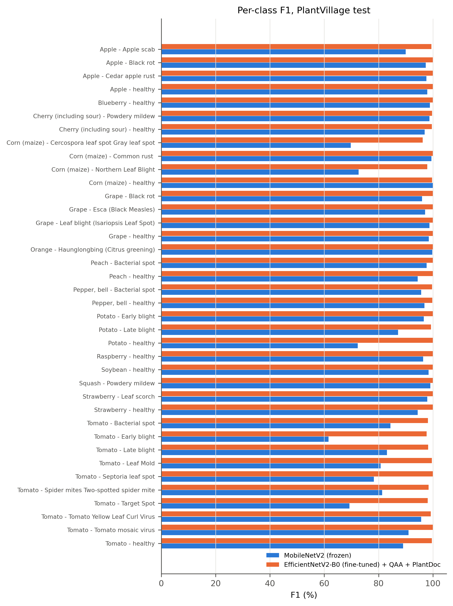
- 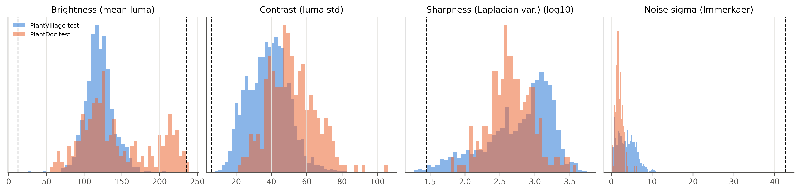
- 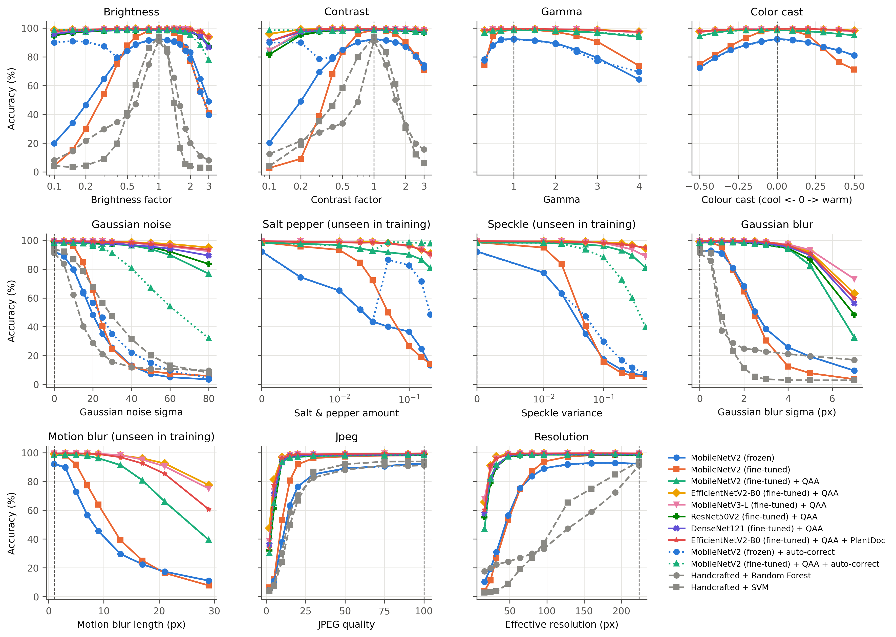
- 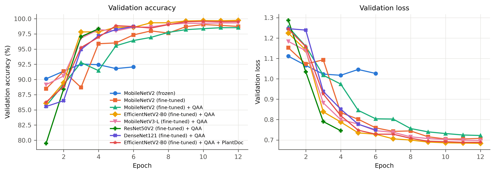
